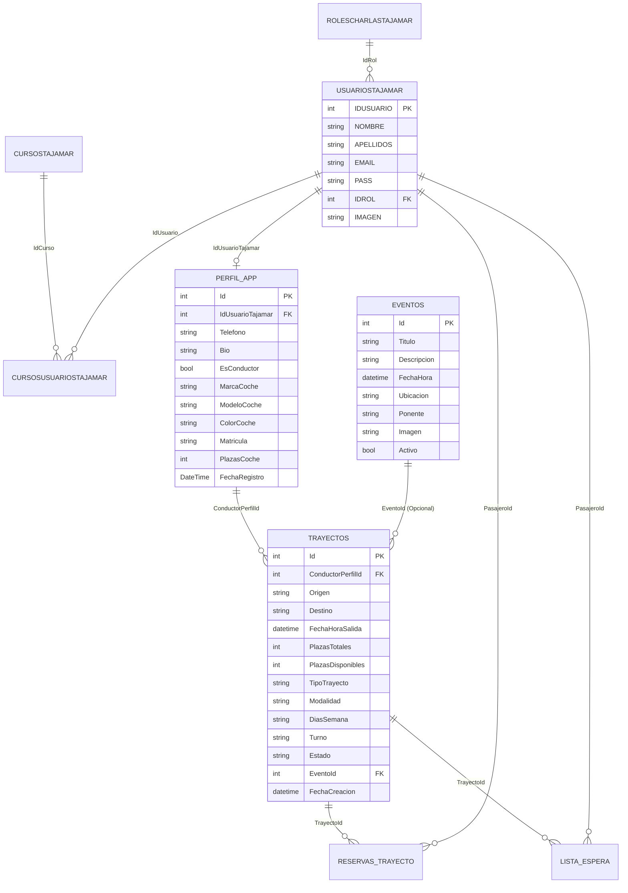

# 🏗️ Arquitectura Técnica del Backend - Tajamar App

Este documento describe la arquitectura, patrones de diseño, modelo de datos y mecanismos de seguridad implementados en el backend de la plataforma de movilidad compartida **Tajamar App**, desarrollado con **.NET 10**, **C#**, **Entity Framework Core 10** y **Azure SQL Server**.

---

## 🏛️ 1. Arquitectura en Capas (Clean Architecture)

El backend sigue los principios de Clean Architecture y separación de responsabilidades, dividiendo el código en tres proyectos desacoplados organizados en `backend/src/`:

```
backend/
├── TajamarApp.slnx
└── src/
    ├── TajamarApp.Core/             # Núcleo de Dominio (Sin dependencias externas)
    │   ├── Entities/                # Entidades de base de datos
    │   ├── DTOs/                    # Data Transfer Objects agrupados por módulo
    │   │   ├── Auth/
    │   │   ├── Perfil/
    │   │   ├── Trayectos/
    │   │   ├── Notificaciones/      # NotificacionDto
    │   │   └── Common/
    │   └── Interfaces/              # Contratos de servicios, clientes e interfaces
    │       ├── IAuthService.cs, IJwtService.cs, ITrayectoService.cs, IReservaService.cs
    │       ├── INotificacionService.cs
    │       └── INotificacionClient.cs
    │
    ├── TajamarApp.Infrastructure/   # Acceso a datos y lógica de infraestructura
    │   ├── Data/                    # DbContext y configuración Fluent API
    │   ├── Migrations/              # Migraciones de EF Core
    │   └── Services/                # Implementación de la lógica de negocio
    │
    └── TajamarApp.API/              # Capa de presentación y servicios REST / WebSockets
        ├── Controllers/             # Controladores REST API
        ├── Features/                # Minimal API Route Groups (Events, Reservations)
        ├── Hubs/                    # Hubs de SignalR y Providers (NotificacionesHub, CustomUserIdProvider)
        ├── Services/                # Servicios API (NotificacionService con IHubContext)
        ├── Properties/              # launchSettings.json y perfiles
        └── Program.cs               # Pipeline HTTP, WebSockets, DI, CORS, JWT y Swagger
```

### 1.1. `TajamarApp.Core`
Es la capa central independiente de frameworks externos o librerías de persistencia.
- **`Entities/`**:
  - Tablas oficiales de Tajamar: `UsuarioTajamar`, `CursoTajamar`, `CursoUsuarioTajamar`, `RolCharlaTajamar`.
  - Tablas de la aplicación: `PerfilApp`, `Trayecto`, `Evento`, `ReservaTrayecto`, `ListaEspera`.
- **`DTOs/`**:
  - `Auth/`: `LoginRequestDto`, `LoginResponseDto`.
  - `Perfil/`: `PerfilDto`, `ActualizarPerfilDto`.
  - `Trayectos/`: `CrearTrayectoDto`, `EditarTrayectoDto`, `FiltroTrayectosDto`, `TrayectoDetalleDto`, `TrayectoResumenDto`, `ConductorResumenDto`, `PasajerosTrayectoDto`.
  - `Notificaciones/`: `NotificacionDto`.
  - `Common/`: `ResultadoPaginadoDto<T>`.
- **`Interfaces/`**:
  - `IAuthService`, `IJwtService`, `ITrayectoService`, `IReservaService`.
  - `INotificacionService`: Contrato de emisión de notificaciones desacoplado de la tecnología de transporte.
  - `INotificacionClient`: Contrato fuertemente tipado para los clientes del Hub de SignalR.

### 1.2. `TajamarApp.Infrastructure`
Implementa el acceso a datos y la interacción con Azure SQL Database.
- **`TajamarAppContext`**: Hereda de `DbContext`. Mapea tanto las tablas preexistentes del ecosistema Tajamar como las nuevas entidades de la aplicación mediante Fluent API.
- **`Services/`**:
  - `AuthService`: Autenticación con verificación de contraseña hash contra `USUARIOSTAJAMAR` y detección de perfil completado (`PERFIL_APP`).
  - `JwtService`: Generación de tokens JWT Bearer firmados con clave simétrica `HMAC-SHA256`.
  - `TrayectoService`: Lógica CRUD, validaciones de conductor, capacidad de vehículo, estados, motor de búsqueda con filtros dinámicos, consulta de pasajeros y emisión de notificaciones de cancelación vía `INotificacionService`.
  - `ReservaService`: Gestión de reservas del pasajero y cancelación en cola FIFO.

### 1.3. `TajamarApp.API`
Punto de entrada Web API y servidor de WebSockets en tiempo real.
- **Controllers**: Controladores REST API (`AuthController`, `PerfilController`, `TrayectosController`, `CursosController`, `UsuariosController`, `ReservasController`, `HealthController`).
- **Features**: Grupos de rutas Minimal API estandarizados (`Events`, `Reservations`) con transacciones optimizadas y concurrencia pesimista.
- **Hubs**: Hubs de comunicación bidireccional (`NotificacionesHub`) y mapeador de identificador de usuario (`CustomUserIdProvider`).
- **Services**: Servicios propios de la capa API como `NotificacionService` (que inyecta `IHubContext<NotificacionesHub, INotificacionClient>`).
- **Program.cs**: Configuración centralizada de:
  - Base de datos (`AddDbContext<TajamarAppContext>`).
  - Autenticación JWT Bearer con soporte para WebSockets (`JwtBearerEvents.OnMessageReceived` interceptando `?access_token=`).
  - SignalR con Hub fuertemente tipado y `IUserIdProvider` personalizado.
  - Swagger / OpenAPI con soporte para el botón `Authorize` (Bearer token) y URLs en minúsculas (`LowercaseUrls = true`).
  - CORS habilitado para el cliente Angular (`http://localhost:4200`).

---

## 🗄️ 2. Modelo de Datos y Persistencia

### 2.1. Conexión a Base de Datos
- **Servidor:** Azure SQL Server (`sqldavidc3597.database.windows.net`).
- **Base de Datos:** `AZURETAJAMAR`.
- **Autenticación:** SQL Authentication vía cadena de conexión protegida en `appsettings.json`.
- **Modo:** Resiliente (reintenta automáticamente ante pausas por inactividad de Azure SQL Serverless).

### 2.2. Diagrama Entidad-Relación y Tablas



---

## 🔐 3. Seguridad y Autenticación

### 3.1. Algoritmo de Verificación de Contraseñas
Tajamar almacena las contraseñas como un hash SHA-256 codificado en Base64.
La verificación en `AuthService` se realiza mediante:

$$\text{Hash} = \text{Base64}(\text{SHA256}(\text{Encoding.Unicode.GetBytes}(\text{password})))$$

*Ejemplo de verificación:* La contraseña por defecto de los 29 alumnos y profesores de prueba es `12345`, cuyo hash resultante es exactamente `OFi9W3uf5kGsaxyTqF1ZFQ==`.

### 3.2. Formato del Token JWT
Al iniciar sesión exitosamente en `POST /api/auth/login`, el servidor devuelve un token firmado con los siguientes Claims estándar:
- `ClaimTypes.NameIdentifier`: `IdUsuario` (entero).
- `idUsuarioTajamar`: `IdUsuario` (entero, compatibilidad cruzada de módulos).
- `ClaimTypes.Email`: Correo institucional (`@tajamar365.com`).
- `ClaimTypes.Name`: Nombre completo del usuario.
- `ClaimTypes.Role`: Rol del usuario en Tajamar (`Alumno`, `Profesor`, etc.).

### 3.3. Flags de Control de Acceso
- `perfilCompletado`: Indica si el usuario ya ha rellenado su ficha en `PERFIL_APP`. Si es `false`, el cliente de Angular redirige al flujo de onboarding.
- `esConductor`: Determina si el usuario tiene permiso para crear trayectos en `POST /api/trayectos`.

---

## ⚙️ 4. Inyección de Dependencias y Ciclo de Vida

En `Program.cs`, los servicios están registrados con ciclo de vida **Scoped** (`AddScoped`), garantizando que cada petición HTTP tenga su propia instancia aislada compartiendo el mismo contexto transaccional de base de datos:

| Servicio / Contrato | Implementación | Ciclo de Vida | Propósito |
| :--- | :--- | :--- | :--- |
| `TajamarAppContext` | `TajamarAppContext` | Scoped | Contexto EF Core y persistencia en Azure SQL |
| `IJwtService` | `JwtService` | Scoped | Generación y firma de tokens JWT |
| `IAuthService` | `AuthService` | Scoped | Validación de credenciales y perfiles |
| `IPerfilService` | `PerfilService` | Scoped | Lógica de negocio de perfiles extendidos de conductor y pasajero |
| `ITrayectoService` | `TrayectoService` | Scoped | Lógica CRUD, filtrado dinámico, gestión de pasajeros y avisos de cancelación |
| `IReservaService` | `ReservaService` | Scoped | Consultas de reservas del usuario y bajas de lista de espera FIFO |
| `INotificacionService` | `NotificacionService` | Scoped | Emisión de notificaciones push en tiempo real hacia el Hub de SignalR |
| `IUserIdProvider` | `CustomUserIdProvider` | Singleton | Mapeo de identidad en WebSockets extrayendo el claim `idUsuarioTajamar` |
| `Database` | `Database` | Singleton | Helper de concurrencia y transacciones ADO.NET para reservas |
| `TimeProvider` | `TimeProvider.System` | Singleton | Abstracción de reloj para pruebas y cálculo de fechas |

---

## 🚀 5. Reglas de Negocio Implementadas

1. **Restricción de Publicación:** Solo los usuarios que hayan marcado `EsConductor == true` en su `PerfilApp` pueden dar de alta trayectos.
2. **Control de Capacidad del Vehículo:** Un conductor con un coche de 4 plazas (`PlazasCoche: 4`) no puede ofertar 5 o más plazas (`PlazasTotales <= PlazasCoche`).
3. **Control de Edición de Plazas:** Al modificar un trayecto, el nuevo cupo de `PlazasTotales` no puede ser inferior a las plazas que ya han sido reservadas por otros alumnos.
4. **Autoría y Propietario:** Únicamente el conductor que creó el trayecto puede editarlo (`PUT`) o cancelarlo (`DELETE`).
5. **Búsqueda Eficiente:** El buscador aplica `AsNoTracking()` para minimizar la huella de memoria y realiza un `CountAsync()` antes de paginar con `.Skip()` y `.Take()`.
6. **Bloqueo Concurrente Anti-Carreras:** En `POST /api/trayectos/{id}/reservar`, la fila se bloquea con `WITH (UPDLOCK, HOLDLOCK)`. Si se agota la última plaza, el estado cambia automáticamente a `Completo` y las solicitudes posteriores reciben `409 PLAZAS_AGOTADAS` invitando a la cola.
7. **Motor de Cola FIFO y Auto-Promoción:** Cuando un pasajero cancela su reserva (`DELETE /api/reservas/{id}`), el sistema examina `COLA_ESPERA`. El primer alumno según FIFO se promociona inmediatamente a reserva `Confirmada` y se reasignan las posiciones de los demás.

---

## 📡 6. Comunicación en Tiempo Real (SignalR)

Para eliminar la sobrecarga de consultas recurrentes (polling) y ofrecer una experiencia reactiva instantánea a pasajeros y conductores, el backend implementa una capa de comunicación basada en **WebSockets** mediante **ASP.NET Core SignalR**:

### 6.1. Hub Fuertemente Tipado (`Hub<INotificacionClient>`)
En lugar de invocar cadenas mágicas de métodos, el Hub `NotificacionesHub` hereda de `Hub<INotificacionClient>`. Esto garantiza seguridad en tiempo de compilación para todos los eventos del cliente:
- `RecibirNotificacion(NotificacionDto)`
- `NuevaReserva(NotificacionDto)`
- `PromocionCola(NotificacionDto)`
- `TrayectoCancelado(NotificacionDto)`

### 6.2. Mapeo de Identidad con `CustomUserIdProvider`
Dado que el identificador relacional del alumno en `USUARIOSTAJAMAR` viaja en el claim personalizado `idUsuarioTajamar`, se implementó un `IUserIdProvider` que prioriza este claim sobre el estándar `NameIdentifier`. Esto permite que el servicio emisor invoque directamente:
```csharp
_hubContext.Clients.User(idUsuario.ToString()).NuevaReserva(notificacion);
```
impactando de forma unívoca a todas las pestañas o dispositivos abiertos por dicho alumno.

### 6.3. Autenticación JWT en Handshake WebSocket
Los navegadores web no permiten configurar cabeceras HTTP personalizadas al instanciar un WebSocket (`new WebSocket(...)`). Por ello, se configuró el middleware de autenticación (`JwtBearerEvents.OnMessageReceived`) para interceptar el token JWT pasado como query parameter:
```csharp
var accessToken = context.Request.Query["access_token"];
var path = context.HttpContext.Request.Path;
if (!string.IsNullOrEmpty(accessToken) && path.StartsWithSegments("/hubs"))
{
    context.Token = accessToken;
}
```
Esto habilita la protección del Hub con el atributo estándar `[Authorize]`, rechazando con `401 Unauthorized` cualquier intento de conexión anónima o con token expirado.

### 6.4. Servicio Orquestador `INotificacionService`
La lógica de negocio de la aplicación (en `Features/Reservations/Reservations.cs` y `Services/TrayectoService.cs`) nunca interactúa directamente con WebSockets ni con sockets de bajo nivel. En su lugar, inyecta `INotificacionService`:
- Desacopla completamente el dominio de los detalles de transporte.
- Centraliza la construcción del DTO enriquecido `NotificacionDto` con sus metadatos (`trayectoId`, `origen`, `destino`, `nombrePasajero`).
- Emite en paralelo (`Task.WhenAll`) hacia el canal específico y hacia el canal general `RecibirNotificacion`.
- Facilita la creación de mocks en pruebas unitarias e integración continua.
